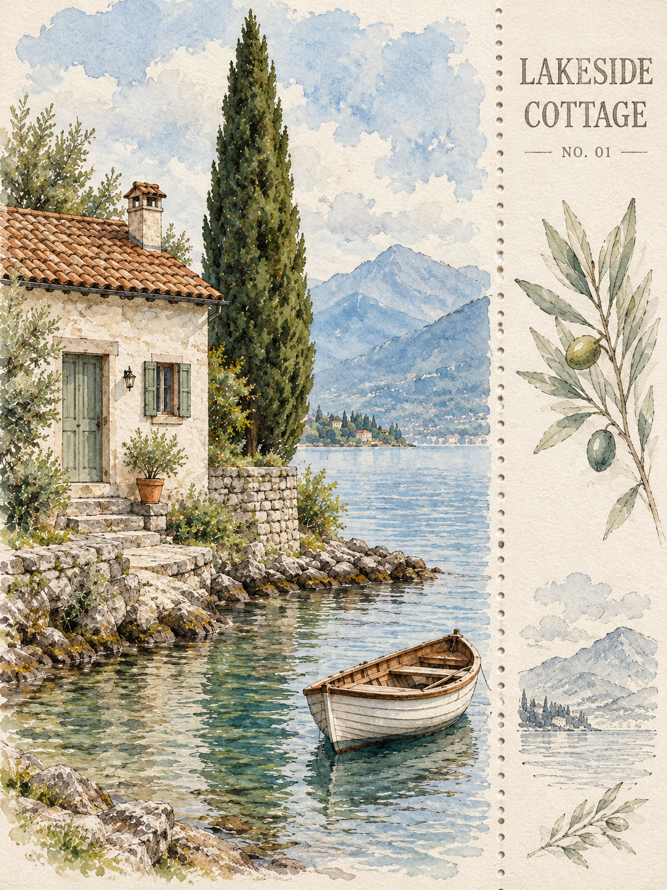

# 原图 → 生成图：对比演示

[返回首页](../README.md) · [来源与状态记录](manifest.json)

## 当前状态

2026-10-15 使用内置 image_gen 完成共享输入图和水彩输出。纸雕与像素的最新调用仍返回 429，尚无输出。该示例展示本次生成结果，不代表上游作者保证相同效果。

| 原图 · AI 生成输入 | 水彩旅行卡 · 生成图 |
| :---: | :---: |
|  |  |

检查结果：小屋、柏树和单艘木船可辨认，标题与编号清晰，纸面、透明水彩和齿孔分隔符合主要方向。右侧档案栏额外出现橄榄枝装饰与小幅风景插图，未严格保持纯粹的简洁档案栏，应视为风格演绎的偏差。输入图的小屋原本在左侧有裁切。

## 重试记录

早期调用返回 HTTP 429；最近一次水彩成功，随后纸雕与像素仍失败。完整历史见 [manifest](manifest.json) 的 `retry_runs`。只展示真实生成且已检查的文件。

## 演示设计

用同一张 3:4 输入图分别生成三张独立作品，GitHub 展示时每组左侧输入、右侧输出，两列等宽，点击可查看原文件。不要把对比版式写进生成请求；上游三个 Skill 都要求独立作品。

输入是一处虚构湖岸：奶油色小屋、陶土屋顶、鼠尾草绿门、柏树、木船与远山。输入本身也由 AI 生成，必须标明，不能冒充用户实拍。

| 方向 | 提示词 | 生成状态 |
| --- | --- | --- |
| 共享输入图 | [输入图提示词](prompts/source.md) | 已生成并检查 |
| 水彩旅行卡 | [水彩提示词与 Skill](prompts/watercolor.md) | 已生成并检查 |
| 纸雕微缩场景 | [纸雕提示词与 Skill](prompts/papercraft.md) | 转换调用失败（429） |
| 像素消散 | [像素提示词与 Skill](prompts/pixel.md) | 转换调用失败（429） |

## 补齐图片时

1. 使用已保存并检查的共享输入图 `examples/images/source.png`。
2. 阅读固定版本 Skill，用同一输入分别生成并检查三种输出，保存到 `examples/images/`。
3. 确认小屋、树、船的数量与位置一致，检查文字和各风格的构图约束；记录偏差。
4. 在 `manifest.json` 中补全实际模型（若工具提供）、日期、输入和输出路径、执行方式与状态。
5. 仅当文件真实存在且已检查时，在首页添加两列图片对比，并更新这里的状态说明。

## 素材与归属

本次仅参考 GZ-L/photo-to-poster-skills 的三个 Skill，固定版本见每份提示词。未复制上游示例图，也未重新分发 Skill 源码。演示图片与上游代码许可应分别记录；不要把目录中所有项目统一标为 MIT。AI 演示不代表原作者发布、认可或保证相同结果。

贡献真实照片时请记录来源与使用授权；不要提交密钥、私人照片或未经允许转载的样图。
